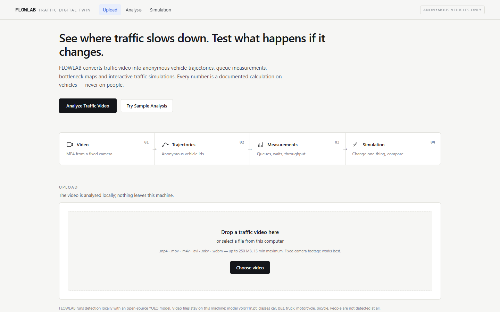
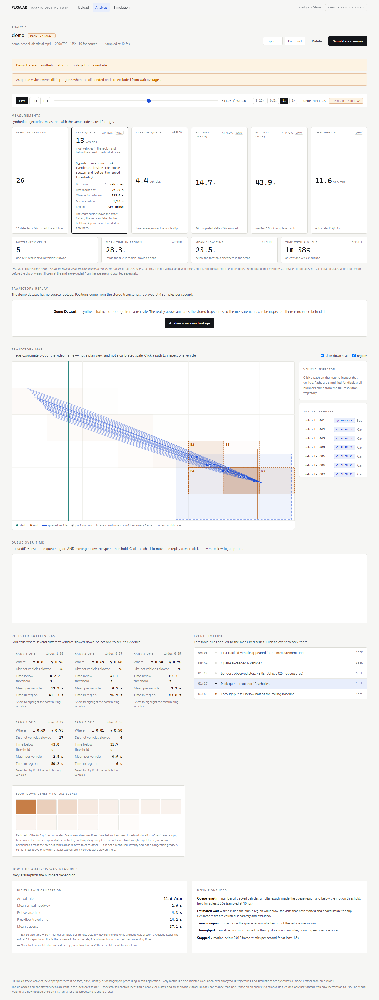
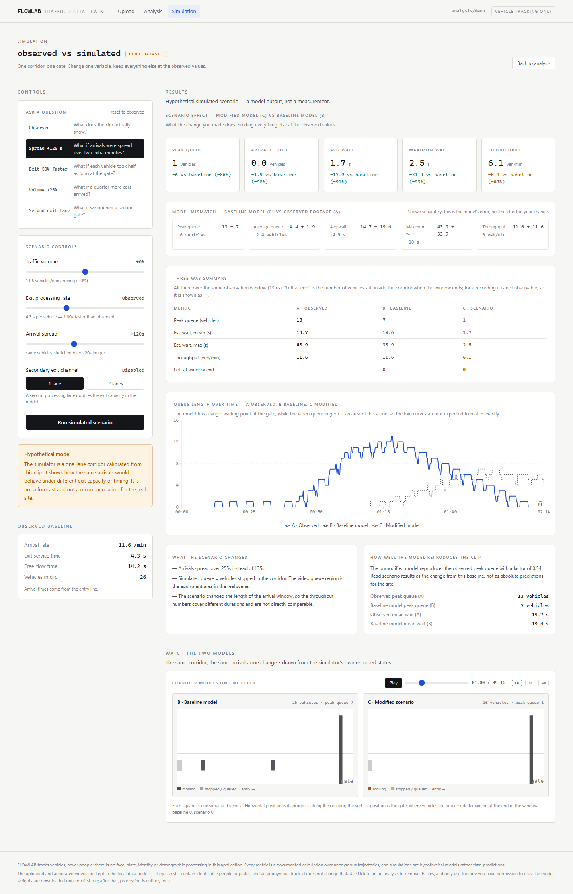
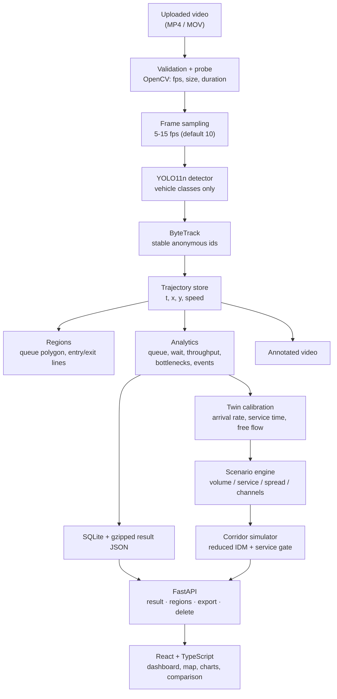

# FLOWLAB

[](https://github.com/sgohils/FLOWLAB/actions/workflows/ci.yml)

**See where traffic slows down. Test what happens if it changes.**

FLOWLAB turns ordinary traffic video into an interactive digital twin: anonymous
vehicle trajectories, explainable queue measurements, bottleneck maps, and a
simplified traffic-flow simulation you can push around.

Upload a clip of a school gate at dismissal time and FLOWLAB will detect the
vehicles, give each one an anonymous id, measure where they queue and how long
they wait, show where traffic repeatedly slows down, and let you test one
operational change against a baseline.

Everything runs locally. There is no cloud service, no account, and no
face, plate or identity processing anywhere in the code.

---

## Contents

1. [Screenshots](#screenshots)
2. [What it does](#what-it-does)
3. [Installation (Windows tested)](#installation)
4. [Running it](#running-it)
5. [Your first analysis](#your-first-analysis)
6. [How the metrics are calculated](#how-the-metrics-are-calculated)
7. [How regions work](#how-regions-work)
8. [The digital twin](#the-digital-twin)
9. [Architecture](#architecture)
10. [API](#api)
11. [Testing](#testing)
12. [Validation](#validation)
13. [Privacy and retention](#privacy-and-retention)
14. [Licences and attribution](#licences-and-attribution)
15. [Limitations](#limitations)
16. [Project layout](#project-layout)
17. [Contributing](#contributing)

---

## Screenshots

| Home | Analysis |
| --- | --- |
|  |  |



The screenshots show the bundled **Demo Dataset** (synthetic), which is
labelled as such in the interface.

---

## What it does

| Stage | Output |
| --- | --- |
| Video | Duration, resolution, fps, size, processing progress |
| Detection | Boxes for vehicle classes only, with confidence |
| Tracking | A stable anonymous id per vehicle and its full trajectory |
| Measurement | Queue length over time, estimated wait, throughput, bottleneck cells |
| Replay | One clock shared by the video, the map, the chart and the event timeline |
| Map | Image-coordinate trajectory plot with per-vehicle inspection |
| Twin | A corridor simulation calibrated from the same clip |
| Scenarios | Volume, exit processing rate, arrival spread, a second exit lane |
| Evidence | Every headline number can be opened to show what produced it |
| Export | JSON summary, three CSVs and a printable brief — no footage in any of them |

Every metric is a count or a difference of timestamps over the tracked vehicles.
There is no opaque "congestion score".

### Where the numbers come from

Every headline card can be opened with **why?**, which shows the formula, the
counts and timestamps that produced the value, and what the number is not. Below
the results, an **evidence and assumptions** panel lists every count the
measurements rest on — crossings in and out, completed versus censored queue
visits, tracking gaps, the share of missing samples and the observation window —
and says plainly when that evidence is too thin to lean on. A measurement that
could not be made reads **unavailable** with its reason, never `0`.

```text
$ python -m backend.scripts.trace_metric demo peak_queue
```

re-derives the displayed peak queue from the raw samples and checks it against
the grid, the API and the event list.

### The connected replay

The analysis page is one instrument, not five screens. A single clock drives:

- **the annotated video** (its own time is the clock when a video is playing),
- **the trajectory map** (one dot per vehicle at the current instant),
- **the queue chart** (a cursor line; click the chart to scrub),
- **the event timeline** (click an event to seek to it),
- **the vehicle inspector** (click a path to select that vehicle).

The replay reads a purpose-built endpoint rather than the thinned map data:
tracks are split into **segments** at tracking gaps, and the position inside a gap
is *unknown*, so the vehicle is hidden rather than drawn somewhere invented. On
the demo dataset the transport is labelled *trajectory replay*, because there is
no source footage behind it.

---

## Installation

**Requirements:** Python 3.11+ (3.13 tested), Node.js 20+ (24 tested), about
2 GB of disk for dependencies.

### The fast path

```bat
run.bat install
run.bat doctor
run.bat
```

`run.bat` finds a working Python even when `python` on your PATH is the
Microsoft Store stub (a real problem on Windows: `py -3` and the
`%LOCALAPPDATA%\Programs\Python\Python3xx\python.exe` locations are tried in
turn). A candidate is not accepted until it has answered both `import sys` and
`-m pip --version`, so a `.venv` that exists but was never populated is reported
by name, with the fix (`run.bat install`, or delete the directory), instead of
failing three commands later with a bare `ImportError`. On macOS or Linux use
`./run.sh install`; the subcommands are the same.

| Subcommand | What it does |
| --- | --- |
| `run.bat` / `start` | the API on :8000 and the Vite dev server on :5173 |
| `run.bat install` | runtime **and** development dependencies, then `npm install` |
| `run.bat lint` | `ruff check backend` plus the source encoding check |
| `run.bat test` | the backend suite plus the encoding check |
| `run.bat build` | the production frontend bundle into `frontend/dist` |
| `run.bat check` | the single health gate: ruff, backend tests, encoding, frontend typecheck, frontend tests, frontend build |
| `run.bat doctor` | environment report; changes nothing |
| `run.bat /?` | the same list |

`check` does **not** run mypy. Type checking is a CI gate only, so run
`python -m mypy` from the repository root when you want it locally.

### Manual install

```bat
python -m pip install -r backend\requirements.txt
python -m pip install -r backend\requirements-dev.txt
cd frontend
npm install
cd ..
```

The second file is the test and lint toolchain (pytest, httpx, ruff, mypy,
pytest-cov). `backend/requirements.txt` is runtime-only and no longer carries
them, so a deployment image installs nothing it does not run.

**`pyproject.toml` is the authoritative dependency list.** The two requirements
files mirror it, because `pip install -r` cannot read a `[project]` table.
`test_requirements_txt_and_pyproject_declare_the_same_bounds` in
`backend/tests/test_doctor.py` compares them, so they cannot drift apart without
a test failing. From the repository root, `pip install -e ".[dev]"` installs both
sets in one step.

<details>
<summary>What is verified about the environment</summary>

On 2026-09-30, Windows 11, Python 3.13.5: `python -m backend.scripts.doctor`
reported every runtime import present and every installed version inside the
bound declared in `backend/requirements.txt` - fastapi 0.141.1, uvicorn
0.54.0, pydantic 2.12.5, numpy 2.5.1, opencv-python 5.0.0, ultralytics 8.4.163,
torch 2.14.0+cpu, pytest 9.1.1 - and `python -m pytest` then reported
**277 passed**.

A clean virtual environment was last installed end to end on 2026-09-27, with
the requirements as they stood then. They have changed since: the OpenCV bound
was widened from `<5` to `<6` to match the installed 5.0.0, and the test
dependencies moved into `backend/requirements-dev.txt`. `run.bat install`
installs both files and is the path the current checkout is documented against;
a fresh-venv install has not been repeated since those two changes.

The install downloads roughly 1.2 GB, most of it torch.
</details>

### Model

Nothing to train. FLOWLAB uses the pretrained **Ultralytics YOLO11n**
checkpoint (`yolo11n.pt`, ~5.6 MB). It is downloaded automatically the first time
a job runs, which needs internet access once; after that the application is
entirely local. To use a local checkpoint instead:

```bat
set FLOWLAB_MODEL=C:\models\yolo11s.pt
```

`run.bat doctor` reports whether the weights are already on disk.

### Configuration

All of them live in `backend/config.py`; nothing else in the code reads an
environment variable. Where a value is marked **clamped**, `config.py` forces it
into range rather than trusting the caller. A value that cannot be parsed falls
back to the default instead of raising, so a typo in a launch script degrades to
the tested behaviour.

| Variable | Default | Meaning | Range |
| --- | --- | --- | --- |
| **Storage** | | | |
| `FLOWLAB_DATA_DIR` | `./data` | Root for uploads, processed videos and the SQLite file | any path |
| **Detector** | | | |
| `FLOWLAB_MODEL` | `yolo11n.pt` | Checkpoint name or path | any Ultralytics model |
| `FLOWLAB_DEVICE` | `auto` | Inference device | `auto`, `cpu`, `0` for GPU 0 |
| `FLOWLAB_CONFIDENCE` | `0.25` | Detection confidence threshold | 0-1 |
| `FLOWLAB_IOU` | `0.50` | NMS IoU threshold | 0-1 |
| `FLOWLAB_IMGSZ` | `640` | Inference image size | positive int; a multiple of 32 in practice |
| `FLOWLAB_TRACKER` | `bytetrack.yaml` | Tracking config passed to Ultralytics | any tracker name Ultralytics ships |
| `FLOWLAB_CLASSES` | all five vehicles | Comma-separated COCO names; names that are not COCO vehicle ids are dropped | `car`, `bus`, `truck`, `motorcycle`, `bicycle` |
| `FLOWLAB_ROI` | unset | `x0,y0,x1,y1` crop applied before inference, in normalised coordinates | `0 <= x0 < x1 <= 1` and `0 <= y0 < y1 <= 1`; anything else disables it |
| **Sampling and smoothing** | | | |
| `FLOWLAB_SAMPLE_FPS` | `10` | Processed frames per second | **clamped** to 5-15 |
| `FLOWLAB_MIN_TRACK_POINTS` | `4` | Tracks shorter than this are detector noise | int >= 1 |
| `FLOWLAB_SMOOTHING_ALPHA` | `0.55` | Contact-point smoothing | **clamped** to 0-1 |
| `FLOWLAB_SMOOTHING_JUMP` | `0.02` | A jump larger than this is real movement and is never smoothed away | normalised units |
| `FLOWLAB_TRAIL_LENGTH` | `20` | Trail length drawn on the annotated video, in samples | int >= 0 |
| **Measurement** | | | |
| `FLOWLAB_SPEED_THRESHOLD` | `0.012` | Below this many frame widths per second counts as slow | positive float |
| `FLOWLAB_MIN_STOP_SECONDS` | `1.5` | Minimum duration of a stop anywhere in the frame | float >= 0 |
| `FLOWLAB_BOTTLENECK_COLS` | `8` | Bottleneck grid columns | int >= 1 |
| `FLOWLAB_BOTTLENECK_ROWS` | `6` | Bottleneck grid rows | int >= 1 |
| `FLOWLAB_BOTTLENECK_MIN_PASSES` | `2` | Distinct slowed vehicles before a cell is reported at all | int >= 1 |
| `FLOWLAB_BOTTLENECK_MAX` | `6` | Bottleneck cells reported in the result | int >= 1 |
| `FLOWLAB_KEEP_RAW_TRACKS` | `true` | Keep full-resolution tracks on disk so a region edit does not re-detect | `1`/`true`/`yes`/`on`, or `0`/`false`/`no`/`off` |
| **Simulation** | | | |
| `FLOWLAB_SIM_PROFILES` | `10` | Vehicles kept for the corridor visualisation | int >= 1 |
| **Upload limits** | | | |
| `FLOWLAB_MAX_UPLOAD_MB` | `250` | Upload size limit, in MB | int >= 1 |
| `FLOWLAB_MAX_DURATION` | `900` | Maximum clip length, in seconds | float > 0 |
| `FLOWLAB_MIN_DURATION` | `2` | Minimum clip length, in seconds | float >= 0 |
| `FLOWLAB_MAX_FRAME_DIM` | `4096` | Longest frame edge accepted | int >= 1 |
| **Jobs** | | | |
| `FLOWLAB_MAX_JOBS` | `1` | Worker threads; one clip is processed at a time by default | int >= 1 |
| `FLOWLAB_MAX_QUEUED` | `3` | Uploads waiting for a worker before new ones are refused with HTTP 429 | int >= 0 |
| **Access** | | | |
| `FLOWLAB_CORS_ORIGINS` | four loopback dev origins | Comma-separated browser origins allowed to call the API | loopback only, see below |

The default for `FLOWLAB_CORS_ORIGINS` is
`http://localhost:5173,http://127.0.0.1:5173,http://localhost:4173,http://127.0.0.1:4173`,
the Vite dev server and the preview server. The API has **no
authentication**, so that list is the only thing standing between a browser on
the machine and every uploaded vehicle on it, and the loopback port binding is
the other half of the same answer. Widening either to a routable host lets any
page at that origin read the raw tracks and the stored file paths, so leave it
on loopback unless you have put authentication in front of the API.

`FLOWLAB_ROI` matters for elevated cameras: 30 m above the gate, a car may be
20 pixels wide, and cropping to the carriageway before inference roughly tripled
the detections on the test clip below.

---

## Running it

```bat
run.bat
```

or by hand, in two terminals:

```bat
python -m uvicorn backend.main:app --host 127.0.0.1 --port 8000
cd frontend && npm run dev
```

Open <http://localhost:5173>. The Vite dev server proxies `/api` to the
backend, so no CORS configuration is needed. API documentation is at
<http://localhost:8000/docs>.

**Single process** (the backend also serves the built interface):

```bat
cd frontend && npm run build
python -m uvicorn backend.main:app --port 8000
```

The API has no authentication and serves local video files. Bind it to
127.0.0.1 and keep it there; do not expose it to a network.

### Docker

The stack is **one application on <http://localhost:8000>**. The backend image
builds the production frontend bundle in a first stage and serves it from the
same origin, so there is no second process to keep in sync and no cross-origin
question to answer.

```bash
docker compose up --build            # one app on :8000
docker compose --profile dev up      # + the Vite dev server on :5173
```

The dev server is behind the `dev` profile precisely so it cannot start by
accident; only that second service needs `FLOWLAB_CORS_ORIGINS` to include the
Vite origin, because only it is a different origin. Both published ports bind to
`127.0.0.1`, for the same reason the local commands do: the API has no
authentication.

**Docker is not installed on the development machine, so this path remains
unverified.** What was checked, by inspection rather than by running it:

- `docker-compose.yml` parses as YAML and declares exactly the two services and
  the one profile described above: `backend` with no profile, publishing
  `127.0.0.1:8000:8000`, and `frontend` in the `dev` profile publishing
  `127.0.0.1:5173:5173`.
- `backend/tests/test_dockerignore.py` (47 tests, run and passing) applies the
  root `.dockerignore` patterns with the same matcher Docker uses and asserts
  that every `COPY` source in both Dockerfiles survives. A pattern added later
  cannot silently delete a file the build needs.
- The ignore file names, per entry, which Dockerfile needs that path, so the
  exclusions can be reviewed against the build rather than trusted on sight.

What was **not** checked: `docker compose build` and `docker compose up` have
never run here. Treat the container path as unproven.

---

### Vercel services

The root [vercel.json](vercel.json) prepares two services in one project:
`backend` (FastAPI) receives `/api/*`, except `/api/blob-upload`, which runs on
`frontend` (Vite + a Node upload function). Frontend receives all other paths;
React navigation falls back to `index.html`. The backend's service
root is `.` so Python can import `backend.main:app` and install dependencies
from the root `pyproject.toml`. There is no separate root `app` application.

Hosted mode uses managed PostgreSQL for metadata, a **private Vercel Blob**
store for uploaded videos and immutable result versions, and **Vercel Queues**
for processing. The private subscriber `backend.worker` runs independently of
API requests, retries transient failures, and stores progress in PostgreSQL.
The browser uploads videos directly to Blob. The frontend's Node function
authorizes uploads through its `BACKEND_URL` service binding to `backend`.
That variable is injected by Vercel at runtime; do not set it yourself or put
it in the static bundle. Leave `VITE_API_URL` unset for same-origin routing.

After connecting the stores and applying the PostgreSQL schema, test all
services from the repository root:

```bash
vercel dev
```

See [the hosted deployment guide](docs/VERCEL.md) for environment variables,
schema setup, importing existing local analyses, and runtime limits. Local
development keeps SQLite, filesystem storage, and the original job runner when
`FLOWLAB_HOSTED` is unset and the process is not running on Vercel.

The hosted configuration has not been deployed or tested against real stores
yet. PyTorch may require Large Functions, and processing must fit the worker's
300-second limit. The API has no user authentication: apply deployment access
protection before hosting sensitive footage. CORS is not authentication.

## Your first analysis

1. Press **Analyse Traffic Video** and drop in an MP4 (or press **Try Sample
   Analysis** to use the bundled synthetic dataset).
2. Watch the nine stages. Processing runs in a worker thread, so the page stays
   responsive; a 20 s clip takes roughly a minute on a CPU.
3. Open **Queue region** on the video and draw the area where vehicles
   accumulate: click to place corners, double-click to close, or press Enter
   to close and Escape to abandon (the overlay is a canvas, so it carries its
   own keyboard path). Every edit re-measures immediately — detection is *not* repeated, so it takes about a
   second. You can also type coordinates instead of clicking.
4. Draw an **Entry line** and an **Exit line** where every vehicle clearly
   passes. A line that some vehicles start *past* will never be crossed by
   them; that mistake is easy to make and is called out in the validation
   report.
5. Read the measurements, click trajectories on the map, then go to
   **Simulate a scenario**.

If a job is interrupted (for example by a restart), it is marked failed with a
message rather than left spinning forever. If the model cannot load, the API
stays up and `/api/health` explains why.

---

## How the metrics are calculated

Every definition below is implemented in `backend/analytics/` and covered by
tests in `backend/tests/`.

### Motion proxy

There is no camera calibration, so speed is never reported in km/h. The **speed
proxy** is the fraction of the frame width a vehicle covers per second:

```text
v = distance(xᵢ₊₁ − xᵢ, yᵢ₊₁ − yᵢ) / Δt     [frame widths per second]
```

The position is the **bottom-centre** of the detection box — the point closest
to the road — not the box centre, which floats above the ground for tall
vehicles and moves differently under camera tilt.

### Queue length

```text
queued(t) = inside(queue region, position(t))
             AND speed(t) < speed_threshold            (default 0.012)
             AND below threshold continuously for ≥ min_queue_seconds  (default 0.5 s)

queue_length(t) = Σ_vehicles queued(t)
Q_peak          = max_t queue_length(t)
Q_avg           = time-average of queue_length(t) over the clip
```

The position is linearly interpolated between samples, and a per-vehicle cursor
guarantees a vehicle is counted at most once per instant — without it the
reported peak could exceed the number of vehicles in the clip, which is a bug
this project actually had.

The 0.5 s rule exists so a single noisy detection cannot create a phantom
queue, and it is deliberately the same kind of rule as the stop definition. It
also means the pipeline lags the raw rule by up to 0.5 s while a queue grows.
That is the whole of the 0.188-vehicle gap in the second validation row; the
region-occupancy comparison, which applies no hold, is unaffected by it.

### Estimated wait, slow time, region time, traversal time

These are four different things and the interface never blurs them.

| Name | Definition |
| --- | --- |
| **Est. wait** | Time inside the queue region *while slow*, for at least `min_queue_seconds` at a time, counting only visits that both started and ended inside the clip |
| **Slow time** | Time below the speed threshold *anywhere in the frame*, in intervals of at least `min_stop_seconds` (default 1.5 s) |
| **Time in region** | Time inside the queue region, moving or not |
| **Traversal time** | Last tracked sample minus first tracked sample of the same id, gaps included |

```text
W_avg = Σ wait_i / N
W_max = max(wait_i)
```

A visit is **censored** and excluded from the averages when its start is unknown
(the vehicle was already queueing in the first frame) or its end is unknown (it
was still queueing in the last frame). Censored counts are shown next to the
completed ones. A visit shorter than `min_queue_seconds` is not a visit at all.

### Throughput

```text
Q = N / Δt          (vehicles per minute)
```

`N` is the number of anonymous vehicles whose trajectory crosses the exit line,
each counted **at most once**. The crossing must be on the finite segment (not
the infinite line), the crossing time is interpolated between the two samples
that straddle it, and samples sitting exactly on the line are skipped rather
than counted twice. A crossing is never inferred across a tracking gap longer
than 2.5 sampling intervals.

`Δt` is the whole clip, which the interface states: a clip that starts and ends
with a queue reports a lower rate than the instantaneous rate in the middle.

**Direction policy.** Each line can count crossings in either direction
(`any`, the default) or only in the direction from the first drawn point to the
second (`forward`), which excludes a vehicle reversing back over the line.

### Exit service time (for the twin)

```text
service_time = 60 / (highest vehicles-per-minute actually leaving
                      the exit while a queue was present)
```

A queue keeps an exit at full capacity, so this window measures the capacity
rather than the arrival rate. It is a **lower bound**. With no queue to measure,
FLOWLAB falls back to the fastest quarter of the departure gaps, and finally to
a documented 3.0 s default. Every fallback is written into the calibration notes
and displayed in the interface.

### Bottleneck cells

The frame is divided into an 8×6 grid. Each cell accumulates five observable
quantities — time below the speed threshold, duration of registered stops, time
inside the queue region, distinct vehicles, and trajectory samples — which are
min-max normalised and combined with fixed weights. The result **ranks** areas
relative to each other. It is not a measured severity and the interface says so.

A cell is reported only when at least two *different* vehicles were measurably
slowed there.

### Event timeline

Threshold rules on the measured series, no generated text: first tracked
vehicle, queue exceeded a threshold, peak queue, queue beginning to clear, queue
cleared, throughput dipping below half the rolling baseline, and the longest
observed stop.

---

## How regions work

Regions are stored in **normalised image coordinates** (`x`, `y` as a fraction
of frame width and height), so resizing the player, the window or the video
never breaks them.

| Region | Shape | Used for |
| --- | --- | --- |
| Queue region | polygon (≥ 3 points) | which vehicles count as queued |
| Entry line | segment (2 points) | arrival times and rate |
| Exit line | segment (2 points) | departures, throughput, service time |
| Conflict area | polygon | reserved for merge analysis |

Editing happens directly on the video, or by typing coordinates, which also
makes region editing usable without a mouse. Validation rejects polygons with
fewer than three points, repeated vertices, self-intersections ("bow ties", for
which inside/outside is undefined) and areas below 0.2 % of the frame.

If no queue region or exit line was drawn, FLOWLAB proposes one from the
trajectories — the bounding box of the cells with the most slow vehicle time,
and lines perpendicular to the average direction of travel. Suggested regions
are visibly marked as provisional and can be cleared or replaced; clearing one
is respected and the affected metric becomes *unavailable* rather than zero.

---

## The digital twin

Vehicles travel along a one-lane corridor of normalised length 1 with a
processing gate at the far end, moving under a reduced Intelligent Driver Model:

```text
s*(v, Δv) = s₀ + max(0, v·T + v·Δv / (2·√(a·b)))
dv/dt     = a · (1 − (v/v₀)⁴ − (s/s*)²)
```

`v₀` comes from the observed free-flow time; `a`, `b`, `s₀`, `T` are standard
car-following values scaled to the corridor. The gate is a virtual stopped
obstacle whenever every processing lane is busy, so a queue forms for the same
reason it forms in reality. Integration is a fixed 0.1 s step and the model uses
**no random numbers at all**, so the same scenario always returns the same
answer.

Calibrated from the footage: the arrival sequence, the arrival rate, the exit
service time, the free-flow time and the observation window.

### Three-way comparison

The simulation page always shows three series, because two of them would be
misleading:

| | What it is |
| --- | --- |
| **A — Observed** | what the camera measured |
| **B — Baseline model** | the unmodified model replaying the same arrivals |
| **C — Modified model** | the model with the scenario applied |

- **Scenario effect** is measured as C against B.
- **Model mismatch** is reported separately as B against A.

Without B, an observed-versus-C difference would be credited to the intervention
even when the model itself is the reason. The baseline always replays the
original arrival series, so a scenario cannot inflate its own fidelity number
(there is a test for that).

With no spreading applied, the scenario runs over **exactly** the observation
window, so throughput numbers cover the same duration. Spreading arrivals is the
only control that lengthens the window, and the result says so.

A **sensitivity range** re-runs the baseline with the estimated exit service
time at 0.75x, 1.0x and 1.5x and reports the resulting spread, because that is
the one parameter the application estimates rather than counts. On the bundled
demo it reads: peak queue 12 / 14 / 17 vehicles and mean wait 27.1 / 37.4 /
56.5 s. It is labelled a *sensitivity range*, not a confidence interval — no
probability has been computed — and the interface uses it as a rule of thumb:
a scenario effect smaller than that spread should not be read as real.

The result is labelled *hypothetical simulated scenario* everywhere. FLOWLAB
never issues a safety claim or a recommendation for a real site.

---

## Architecture



One pass over the clip decodes, samples, detects, tracks and renders the
annotated video. The analytics then walk the trajectories once; the same walk
re-runs after a region change because the full-resolution trajectories are kept
on disk and the browser only receives a thinned copy.

### The layering rule

Imports run in **one direction only**. Nothing below ever imports from above.

```text
main.py  ->  api/  ->  analytics/ | simulation/ | vision/  ->  models/  ->  storage/
                                                 \
                                                  ->  geometry.py
```

`backend/geometry.py` is the **bottom** of the stack. It holds the pure planar
primitives (polygon area and centroid, point-in-polygon, first crossing time,
segment intersection, polyline simplification) and imports nothing from the
project at all. It exists as its own module because `models/schemas.py` needs a
polygon area to reject a too-small measurement region, and `analytics/` imports
`models/`, so `models/` can never import from `analytics/` without a cycle.
Anything added to `geometry.py` must stay standard-library only; a helper that
needs the schemas or an analytics result belongs in the layer that owns that
data. `backend/analytics/geometry.py` is now a re-export shim, so the existing
imports keep working and there is exactly one implementation.

`models/schemas.py` is the single API contract. The frontend mirrors it in
`frontend/src/types/index.ts`; changing one without the other is what
`npm run typecheck` is there to catch.

---

## API

Interactive documentation: <http://localhost:8000/docs>

| Method | Endpoint | Purpose |
| Method | Endpoint | Purpose |
| --- | --- | --- |
| `GET` | `/api/health` | API status, whether the model is loaded |
| `GET` | `/api/meta` | Model, classes, limits, processing stages |
| `POST` | `/api/uploads` | Upload a video and start processing |
| `GET` | `/api/analyses` | Recent analyses (`?limit=`, 1-100) |
| `GET` | `/api/demo` | The bundled demo dataset |
| `GET` | `/api/analyses/{id}/status` | Job status and per-stage progress |
| `GET` | `/api/analyses/{id}/result` | Full result (`?trajectory_points=`) |
| `GET` | `/api/analyses/{id}/timeline` | Replay data, split at tracking gaps (`?hz=`) |
| `PUT` | `/api/analyses/{id}/regions` | Re-measure with new regions (`?trajectory_points=`) |
| `GET` | `/api/analyses/{id}/video/annotated` | The rendered video with the region overlay |
| `GET` | `/api/analyses/{id}/video/source` | The uploaded clip, byte-range capable |
| `GET` | `/api/analyses/{id}/simulation/presets` | The scenario presets for this analysis |
| `GET` | `/api/analyses/{id}/export/summary.json` | Full result, no video |
| `GET` | `/api/analyses/{id}/export/vehicles.csv` | Per-vehicle measurements |
| `GET` | `/api/analyses/{id}/export/queue.csv` | Queue length series |
| `GET` | `/api/analyses/{id}/export/events.csv` | Events, bottlenecks, stops |
| `GET` | `/api/analyses/{id}/export/measurements` | Headline numbers with definitions |
| `DELETE` | `/api/analyses/{id}` | Delete the record **and all its files** |
| `POST` | `/api/analyses/{id}/simulate` | Run one scenario |

`?trajectory_points=` (default 60, clamped 4-600) is honoured by **both**
`GET .../result` and `PUT .../regions`, so the map resolution a client gets back
is the same whether it drew new regions or simply reloaded the page. The two
endpoints used to disagree, which meant a re-measure silently redrew the map at
a different resolution.

Errors always come back as `{"message": "...", "hint": "..."}`. `api_error()` in
`backend/api/errors.py` is the single way any route raises a 4xx or a 5xx, so the client never has to
guess, and a Python traceback never reaches it.

---

## Testing

The whole health gate is one command:

```bat
run.bat check
```

which runs, in order: `ruff check backend` -> the pytest suite -> the source
encoding check -> `npm run typecheck` -> `npm test` -> `npm run build`. It is the
same set of checks CI runs, minus mypy (see below). The individual pieces are
`run.bat lint` and `run.bat test`.

**277 backend tests and 50 frontend tests, none of which touch the network or
run model inference.** They cover the parts that would otherwise produce wrong
numbers quietly:

| Area | Examples |
| --- | --- |
| Geometry | point-in-polygon including boundaries and concave shapes, finite-segment crossings, self-intersecting region rejection |
| Queue | counting, simultaneous queues, left- and right-censoring, the never-double-count invariant, the duration threshold, bucket-max thinning |
| Stops | long vs short stops, gaps longer than the sampling interval |
| Wait | averages, medians, maxima, censoring, repeated visits |
| Throughput | crossing counts, direction policy, on-line jitter, gap handling |
| Timeline | uniform-in-time resampling, segment splitting at dropouts, no position invented inside a gap, payload bounds |
| Simulation | determinism, queue growth, second lane, faster service, spread arrivals, no overtaking, window alignment, the sensitivity range |
| Evidence | what each measurement was made from, thin-evidence rules, loading a result stored by an older build |
| Ground truth | the reference series, the script's choice of which series to compare against, the labelled fallback |
| Data lifecycle | delete removes every file, exports contain no footage or filename, interrupted jobs are recovered |
| Storage | every connection is closed, the queue really is bounded, the schema survives a reopen |
| Job failures | a failed analysis reaches the database as `error`, not stuck at `processing` |
| Package layout | `requirements.txt` and `pyproject.toml` do not drift, the ignore file cannot delete a build input |
| Doctor | the version bounds are read from the file and compared with what is installed |
| API | health, meta, demo, upload validation, region validation, export contract, three-way comparison, timeline contract, error shape |

The frontend suite is **vitest + @testing-library/react on jsdom**, four files,
colocated with the code they cover: `utils/format.test.ts`,
`types/index.test.ts`, `state/ReplayContext.test.tsx` and
`components/Primitives.test.tsx`. It asserts on what a user can see
(`screen.getByText`) rather than on snapshots, because a snapshot of a rendered
tree is a picture of the component, not a statement about its behaviour.

### Engineering quality, stated plainly

- **Lint** - ruff over `backend/`, configured in `pyproject.toml`
  (`E,F,I,UP,B,C4,SIM,RET,PTH,ARG,N,RUF`). Clean.
- **Types** - mypy over 38 source files with `check_untyped_defs`, clean.
  `backend/scripts/` and `backend/tests/` are excluded and say so in the config.
  mypy runs in CI but **not** in `run.bat check`; run it yourself with
  `python -m mypy`.
- **Coverage** - 84 % line-and-branch over the measured package
  (2907 statements, 406 missed), `backend/scripts` and `backend/tests` omitted
  because they are operator tooling and are measured by their own assertions.
  The vision layer is the weak part: `video_processor.py` at 22 % and
  `trajectories.py` at 28 %, because running them means running inference.
- **CI** - `.github/workflows/ci.yml`, two jobs on every push and pull request:
  backend on Python 3.11 and 3.13 (ruff, mypy, pytest with coverage, encoding),
  frontend on Node 20 and 24 (`npm ci`, typecheck, test, build). `ci.yml` sets
  `FLOWLAB_MODEL` to a path that cannot resolve so the job cannot download a
  6 MB checkpoint to prove that imports work.
- **Warnings are errors** - `filterwarnings = ["error"]` in pytest, with exactly
  one narrowly scoped ignore for a deprecation raised inside starlette.
- **Pre-commit** - `.pre-commit-config.yaml` runs the same ruff and encoding
  checks on the files you touched.
- **Accessibility** - a global `:focus-visible` ring, `prefers-reduced-motion`
  respected, `aria-live` on the processing status, named icon-only controls, a
  skip link and real landmarks, and the video draw tools genuinely operable with
  Enter and Escape (the on-screen help had always promised "press Enter"; nothing
  implemented it).

None of that is a claim of correctness. It is a claim that a wrong number has to
get past a linter, a type checker, 327 automated tests and a second reviewer
before it reaches you.

One more check worth knowing about:

```bat
python -m backend.scripts.check_encoding
```

It scans every source file for byte-order marks and cp1252 mojibake — damage
that is invisible in a diff and shows up in the interface as `1280×720`. It
exists because that damage was caused during development.

---

## Validation

Two different questions, answered separately, in
[`docs/VALIDATION_REPORT.md`](docs/VALIDATION_REPORT.md):

**Are the measurements right?** Yes, against ground truth that is known by
construction. The demo scene is rendered from a simulation, so the true
position of every vehicle is known:

```bash
python -m backend.scripts.build_demo_dataset
python -m backend.scripts.validate_against_reference backend/demo/sample_reference.json
```

| Quantity | Reference | Computed | Error |
| --- | --- | --- | --- |
| Arrivals | 26 | 26 | 0 |
| Exit crossings | 26 | 26 | 0 |
| Region occupancy, 1350 instants | occupancy counts | occupancy series | mean abs. error **0.028 vehicles**, max 1, exact on 97.2 % |
| Queue length (slow rule), 1350 instants | slow-rule counts | queued series | mean abs. error **0.188 vehicles**, max 2, exact on 81.8 % |

The first row is the like-for-like one: the application's **region occupancy**
(every vehicle inside the polygon, at any speed) against the reference's own
occupancy counts, which are built with the same purely geometric rule. Its
residual is 0.028 vehicles and comes from the stored series being thinned to 675
samples for the chart, not from a definition gap.

The second row is a different quantity, the application definition (inside the
polygon *and* below the speed threshold for at least 0.5 s), against the
reference's slow-rule counts, which apply no hold. That 0.188-vehicle gap is
explained by the deliberate 0.5 s stability rule and is reported separately so
the two are never conflated.

**Does the detector find the right vehicles in real footage?** **Not yet
validated.** That needs a clip you are permitted to use and annotations you
write yourself; the tooling and a template are in `backend/validation/`. No
accuracy number is claimed for it anywhere.

Qualitative behaviour on a hard public-domain clip (distant 24× time-lapse,
20 s, 150 frames processed in 59.8 s on CPU): 19 tracks created, 13 surviving
the noise filter, median track length 8 samples. Cropping to the carriageway
roughly tripled the detections, which is what the ROI control is for.

---

## Privacy and retention

**What FLOWLAB does not do:** no face, plate, identity or demographic
processing; no cloud upload; no telemetry; no accounts. Only COCO vehicle
classes are requested from the detector, and the detector module re-checks the
class of every box it accepts.

**What is still true of the footage, and is stated in the interface, the
footer and the docs:** the uploaded video and the annotated video are stored on
this machine and can contain identifiable people and number plates. An anonymous
track id does not anonymise the source footage.

**Retention:** nothing is deleted automatically. Files live under
`data/` (`uploads/`, `processed/<id>/`, `flowlab.db`) until **Delete** is
pressed on an analysis, which removes the upload, the annotated video, the
result payload and the database row, and reports how many files and how many
bytes it freed.

**Exports** contain measurements only: no video, no frames, no original
filename (a filename like `St Marys dismissal.mp4` is identifying) and no local
file paths. Every export carries its own definitions and a privacy note.

**Network activity:** one request on first use, to download the YOLO weights.
After that the application is entirely local. It is not "completely offline"
until the weights are on disk.

**Before a public demonstration:** use footage you are permitted to use. Do not
show private school footage of children on a shared machine.

---

## Licences and attribution

FLOWLAB's own code is MIT. The components it depends on carry their own terms,
and a school project is not automatically exempt from them:

| Component | Licence |
| --- | --- |
| **Ultralytics YOLO (package and `yolo11n.pt` weights)** | **AGPL-3.0.** For a personal, classroom or non-commercial submission this is generally fine, but check the terms yourself before distributing anything or using it commercially. |
| COCO dataset (the weights were trained on it) | images have individual licences; the annotations are CC BY 4.0 |
| FastAPI, Pydantic, Uvicorn | MIT / BSD |
| OpenCV | Apache 2.0 |
| NumPy, pandas, SciPy | BSD |
| React, React Router, Vite, Tailwind, Recharts | MIT |

Check each project's own licence file before you rely on it — this table is a
pointer, not legal advice.

---

## Limitations

- **No camera calibration.** Positions and speeds are in image coordinates.
  Nothing is reported in metres, km/h or veh/h/lane, and the interface never
  claims otherwise.
- **The detector is unvalidated on real footage.** See above.
- **One corridor, one gate.** Merges, signals, opposing traffic, multiple
  approaches and pedestrians are not modelled.
- **The model reproduces the demo clip's peak queue with a factor of 0.54.**
  Scenario results are meaningful as a change from the baseline, not as
  absolute predictions.
- **A queue of one is ambiguous.** A car pausing at a kerb looks the same as a
  car joining a queue, which is why capacity is only measured while at least
  two vehicles are waiting.
- **Distant and time-lapse footage defeats the detector.** Vehicles that are a
  few pixels wide are missed, and vehicles that move several car lengths between
  sampled frames never register as slow.
- **Clips must contain moving vehicles.** A single parked frame produces tracks
  too short to measure, and the application says so rather than returning zeros.
- **Sampling sensitivity is unmeasured.** It is not known how much the metrics
  move between 5 and 15 fps; doing that study is a listed task.
- **The sensitivity range is not a confidence interval.** The exit service time
  is re-run at 0.75x, 1.0x and 1.5x and the spread is reported, but no
  probability has been computed and none should be inferred from it.
- **The container image has never been built.** Docker is not installed on the
  development machine. The compose file and the build inputs are verified; the
  build and the running container are not.
- **Continuous integration has never run.** The workflow is configured and every
  one of its steps was executed by hand locally, but no hosted run of the
  Python 3.11 or Node 20 leg exists yet.

---

## Project layout

```text
flowlab/
├── README.md
├── CONTRIBUTING.md            how to set up, the layering rule, the house rules
├── pyproject.toml             the authoritative dependency list; ruff, mypy,
│                              pytest, coverage configuration
├── .pre-commit-config.yaml    ruff and the encoding check on changed files
├── .editorconfig              line endings, indentation, final newline
├── .dockerignore              keeps the build context to what the images COPY
├── .github/workflows/ci.yml   backend on py3.11+3.13, frontend on node20+24
├── run.bat / run.sh           one command to install, check, test and start
├── docker-compose.yml         one app on :8000; `--profile dev` adds Vite
├── docs/
│   ├── PROJECT_ASSESSMENT.md  what works, what fails, what is untested
│   ├── VERIFICATION.md        the commands run, and their actual output
│   ├── READINESS_AUDIT.md     the earlier defect sweep and its resolutions
│   ├── VALIDATION_REPORT.md   measured accuracy, and what is still unvalidated
│   ├── ENGINEERING_DECISIONS.md  design choices, alternatives, tradeoffs
│   ├── AI_ASSISTANCE.md       what AI wrote and what it did not
│   ├── STUDENT_CONTRIBUTIONS.md
│   ├── DEMO_SCRIPT.md         a timed 2m45s script and shot list
│   ├── SUBMISSION_DRAFT.md
│   ├── JUDGE_QA.md
│   └── screenshots/
├── backend/
│   ├── main.py                FastAPI app, error handling, SPA hosting
│   ├── config.py              every tunable, environment overrides
│   ├── geometry.py            pure geometry primitives, no project imports
│   ├── api/                   routes, job manager, exports, one error shape
│   ├── vision/                detector, trajectories, annotator, video processor
│   ├── analytics/             geometry (re-export), motion, queue, wait,
│   │                          throughput, bottlenecks, events, suggestions,
│   │                          timeline, orchestrator
│   ├── simulation/            calibration, scenarios, corridor simulator
│   ├── models/schemas.py      the Pydantic contract for the whole API
│   ├── storage/               SQLite and file helpers
│   ├── validation/            how to write reference annotations
│   ├── scripts/               demo dataset, doctor, validation, test clips
│   ├── demo/                  the bundled synthetic dataset and its ground truth
│   ├── requirements.txt       runtime dependencies only
│   ├── requirements-dev.txt  pytest, httpx, ruff, mypy, pytest-cov
│   └── tests/                 277 tests
└── frontend/
    ├── vitest.config.ts       jsdom, Testing Library, reuses the Vite config
    └── src/
        ├── api/client.ts      typed client, one error shape
        ├── types/index.ts     TypeScript mirror of the schemas
        ├── state/             analysis context, shared replay clock
        ├── components/        uploader, viewer, region editor, replay transport,
        │                      map, charts, evidence panels, print brief,
        │                      recent analyses panel, degraded-mode banner
        ├── pages/             Home, Analysis, Simulation, NotFound
        ├── test/setup.ts      jest-dom matchers for Testing Library
        ├── utils/format.ts    shared formatting
        └── *.test.ts(x)       50 tests, colocated with what they cover
```

---

## Contributing

[`CONTRIBUTING.md`](CONTRIBUTING.md) has the development setup, the one-directional
layering rule, the seven house rules the test suite defends, and how to
write a test that can actually fail.

---

## Licence

MIT for this repository. The bundled YOLO weights are **not** covered by it —
Ultralytics is AGPL-3.0. See [Licences and attribution](#licences-and-attribution).
