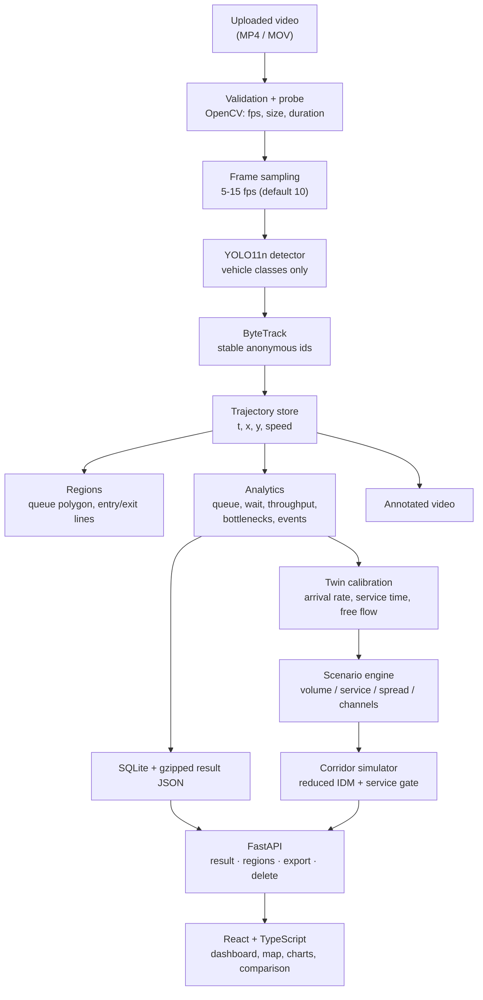

# FLOWLAB

**See where traffic slows down. Test what happens if it changes.**

FLOWLAB turns ordinary traffic video into an interactive digital twin: anonymous
vehicle trajectories, explainable queue measurements, bottleneck maps, and a
simplified traffic-flow simulation you can push around.

Upload a clip of a school gate at dismissal time and FLOWLAB will detect the
vehicles, give each one an anonymous id, measure where they queue and how long
they wait, show where traffic repeatedly slows down, and let you test one
operational change against a baseline.

Everything runs locally. There is no cloud service, no account, and no
face, plate or identity processing anywhere in the code.

---

## Contents

1. [Screenshots](#screenshots)
2. [What it does](#what-it-does)
3. [Installation (Windows tested)](#installation)
4. [Running it](#running-it)
5. [Your first analysis](#your-first-analysis)
6. [How the metrics are calculated](#how-the-metrics-are-calculated)
7. [How regions work](#how-regions-work)
8. [The digital twin](#the-digital-twin)
9. [Architecture](#architecture)
10. [API](#api)
11. [Testing](#testing)
12. [Validation](#validation)
13. [Privacy and retention](#privacy-and-retention)
14. [Licences and attribution](#licences-and-attribution)
15. [Limitations](#limitations)
16. [Project layout](#project-layout)

---

## Screenshots

| Home | Analysis |
| --- | --- |
|  |  |


The screenshots show the bundled **Demo Dataset** (synthetic), which is
labelled as such in the interface.

---

## What it does

| Stage | Output |
| --- | --- |
| Video | Duration, resolution, fps, size, processing progress |
| Detection | Boxes for vehicle classes only, with confidence |
| Tracking | A stable anonymous id per vehicle and its full trajectory |
| Measurement | Queue length over time, estimated wait, throughput, bottleneck cells |
| Replay | One clock shared by the video, the map, the chart and the event timeline |
| Map | Image-coordinate trajectory plot with per-vehicle inspection |
| Twin | A corridor simulation calibrated from the same clip |
| Scenarios | Volume, exit processing rate, arrival spread, a second exit lane |
| Evidence | Every headline number can be opened to show what produced it |
| Export | JSON summary, three CSVs and a printable brief — no footage in any of them |

Every metric is a count or a difference of timestamps over the tracked vehicles.
There is no opaque "congestion score".

### The connected replay

The analysis page is one instrument, not five screens. A single clock drives:

- **the annotated video** (its own time is the clock when a video is playing),
- **the trajectory map** (one dot per vehicle at the current instant),
- **the queue chart** (a cursor line; click the chart to scrub),
- **the event timeline** (click an event to seek to it),
- **the vehicle inspector** (click a path to select that vehicle).

The replay reads a purpose-built endpoint rather than the thinned map data:
tracks are split into **segments** at tracking gaps, and the position inside a gap
is *unknown*, so the vehicle is hidden rather than drawn somewhere invented. On
the demo dataset the transport is labelled *trajectory replay*, because there is
no source footage behind it.

---

## Installation

**Requirements:** Python 3.11+ (3.13 tested), Node.js 18+ (24 tested), about
2 GB of disk for dependencies.

### The fast path

```bat
run.bat install
run.bat doctor
run.bat
```

`run.bat` finds a working Python even when `python` on your PATH is the
Microsoft Store stub (a real problem on Windows: `py -3` and the
`%LOCALAPPDATA%\Programs\Python\Python3xx\python.exe` locations are tried in
turn). On macOS or Linux use `./run.sh install`.

### Manual install

```bat
python -m pip install -r backend\requirements.txt
cd frontend
npm install
cd ..
```

<details>
<summary>Verified on a clean virtual environment</summary>

```bat
python -m venv .venv
.venv\Scripts\python -m pip install -r backend\requirements.txt
.venv\Scripts\python -m pytest backend/tests -q
```

Result on 2026-09-27, Windows 11, Python 3.13.5: install finished with exit
code 0, resolving fastapi 0.141.1, opencv-python 4.14.0.94, numpy 2.5.3,
ultralytics 8.4.164, torch 2.14.0+cpu, pydantic 2.13.5; `python -m pytest` then
reported **129 passed**. The install downloads roughly 1.2 GB, most of it torch.
</details>

### Model

Nothing to train. FLOWLAB uses the pretrained **Ultralytics YOLO11n**
checkpoint (`yolo11n.pt`, ~5.6 MB). It is downloaded automatically the first time
a job runs, which needs internet access once; after that the application is
entirely local. To use a local checkpoint instead:

```bat
set FLOWLAB_MODEL=C:\models\yolo11s.pt
```

`run.bat doctor` reports whether the weights are already on disk.

### Configuration

| Variable | Default | Meaning |
| --- | --- | --- |
| `FLOWLAB_DATA_DIR` | `./data` | Uploads, processed videos, SQLite file |
| `FLOWLAB_MODEL` | `yolo11n.pt` | Detector checkpoint |
| `FLOWLAB_DEVICE` | `auto` | `auto`, `cpu`, or `0` for GPU 0 |
| `FLOWLAB_SAMPLE_FPS` | `10` | Processed frames per second (5–15) |
| `FLOWLAB_CONFIDENCE` | `0.25` | Detector confidence threshold |
| `FLOWLAB_CLASSES` | all vehicles | Comma-separated COCO class names |
| `FLOWLAB_ROI` | – | `x0,y0,x1,y1` crop applied before inference |
| `FLOWLAB_MAX_UPLOAD_MB` | `250` | Upload size limit |
| `FLOWLAB_MAX_DURATION` | `900` | Maximum clip length in seconds |
| `FLOWLAB_MAX_QUEUED` | `3` | Uploads queued before new ones are refused |

`FLOWLAB_ROI` matters for elevated cameras: 30 m above the gate, a car may be
20 pixels wide, and cropping to the carriageway before inference roughly tripled
the detections on the test clip below.

---

## Running it

```bat
run.bat
```

or by hand, in two terminals:

```bat
python -m uvicorn backend.main:app --host 127.0.0.1 --port 8000
cd frontend && npm run dev
```

Open <http://localhost:5173>. The Vite dev server proxies `/api` to the
backend, so no CORS configuration is needed. API documentation is at
<http://localhost:8000/docs>.

**Single process** (the backend also serves the built interface):

```bat
cd frontend && npm run build
python -m uvicorn backend.main:app --port 8000
```

The API has no authentication and serves local video files. Bind it to
127.0.0.1 and keep it there; do not expose it to a network.

### Docker

```bash
docker compose up --build
```

The Docker path has **not** been executed on the development machine, so treat
it as unverified.

---

## Your first analysis

1. Press **Analyse Traffic Video** and drop in an MP4 (or press **Try Sample
   Analysis** to use the bundled synthetic dataset).
2. Watch the nine stages. Processing runs in a worker thread, so the page stays
   responsive; a 20 s clip takes roughly a minute on a CPU.
3. Open **Queue region** on the video and draw the area where vehicles
   accumulate: click to place corners, double-click to close. Every edit
   re-measures immediately — detection is *not* repeated, so it takes about a
   second. You can also type coordinates instead of clicking.
4. Draw an **Entry line** and an **Exit line** where every vehicle clearly
   passes. A line that some vehicles start *past* will never be crossed by
   them; that mistake is easy to make and is called out in the validation
   report.
5. Read the measurements, click trajectories on the map, then go to
   **Simulate a scenario**.

If a job is interrupted (for example by a restart), it is marked failed with a
message rather than left spinning forever. If the model cannot load, the API
stays up and `/api/health` explains why.

---

## How the metrics are calculated

Every definition below is implemented in `backend/analytics/` and covered by
tests in `backend/tests/`.

### Motion proxy

There is no camera calibration, so speed is never reported in km/h. The **speed
proxy** is the fraction of the frame width a vehicle covers per second:

```text
v = distance(xᵢ₊₁ − xᵢ, yᵢ₊₁ − yᵢ) / Δt     [frame widths per second]
```

The position is the **bottom-centre** of the detection box — the point closest
to the road — not the box centre, which floats above the ground for tall
vehicles and moves differently under camera tilt.

### Queue length

```text
queued(t) = inside(queue region, position(t))
             AND speed(t) < speed_threshold            (default 0.012)
             AND below threshold continuously for ≥ min_queue_seconds  (default 0.5 s)

queue_length(t) = Σ_vehicles queued(t)
Q_peak          = max_t queue_length(t)
Q_avg           = time-average of queue_length(t) over the clip
```

The position is linearly interpolated between samples, and a per-vehicle cursor
guarantees a vehicle is counted at most once per instant — without it the
reported peak could exceed the number of vehicles in the clip, which is a bug
this project actually had.

The 0.5 s rule exists so a single noisy detection cannot create a phantom
queue, and it is deliberately the same kind of rule as the stop definition. It
also means the pipeline lags the raw rule by up to 0.5 s while a queue grows,
which is the entire explanation for the residual error in the validation report.

### Estimated wait, slow time, region time, traversal time

These are four different things and the interface never blurs them.

| Name | Definition |
| --- | --- |
| **Est. wait** | Time inside the queue region *while slow*, for at least `min_queue_seconds` at a time, counting only visits that both started and ended inside the clip |
| **Slow time** | Time below the speed threshold *anywhere in the frame*, in intervals of at least `min_stop_seconds` (default 1.5 s) |
| **Time in region** | Time inside the queue region, moving or not |
| **Traversal time** | Last tracked sample minus first tracked sample of the same id, gaps included |

```text
W_avg = Σ wait_i / N
W_max = max(wait_i)
```

A visit is **censored** and excluded from the averages when its start is unknown
(the vehicle was already queueing in the first frame) or its end is unknown (it
was still queueing in the last frame). Censored counts are shown next to the
completed ones. A visit shorter than `min_queue_seconds` is not a visit at all.

### Throughput

```text
Q = N / Δt          (vehicles per minute)
```

`N` is the number of anonymous vehicles whose trajectory crosses the exit line,
each counted **at most once**. The crossing must be on the finite segment (not
the infinite line), the crossing time is interpolated between the two samples
that straddle it, and samples sitting exactly on the line are skipped rather
than counted twice. A crossing is never inferred across a tracking gap longer
than 2.5 sampling intervals.

`Δt` is the whole clip, which the interface states: a clip that starts and ends
with a queue reports a lower rate than the instantaneous rate in the middle.

**Direction policy.** Each line can count crossings in either direction
(`any`, the default) or only in the direction from the first drawn point to the
second (`forward`), which excludes a vehicle reversing back over the line.

### Exit service time (for the twin)

```text
service_time = 60 / (highest vehicles-per-minute actually leaving
                      the exit while a queue was present)
```

A queue keeps an exit at full capacity, so this window measures the capacity
rather than the arrival rate. It is a **lower bound**. With no queue to measure,
FLOWLAB falls back to the fastest quarter of the departure gaps, and finally to
a documented 3.0 s default. Every fallback is written into the calibration notes
and displayed in the interface.

### Bottleneck cells

The frame is divided into an 8×6 grid. Each cell accumulates five observable
quantities — time below the speed threshold, duration of registered stops, time
inside the queue region, distinct vehicles, and trajectory samples — which are
min-max normalised and combined with fixed weights. The result **ranks** areas
relative to each other. It is not a measured severity and the interface says so.

A cell is reported only when at least two *different* vehicles were measurably
slowed there.

### Event timeline

Threshold rules on the measured series, no generated text: first tracked
vehicle, queue exceeded a threshold, peak queue, queue beginning to clear, queue
cleared, throughput dipping below half the rolling baseline, and the longest
observed stop.

---

## How regions work

Regions are stored in **normalised image coordinates** (`x`, `y` as a fraction
of frame width and height), so resizing the player, the window or the video
never breaks them.

| Region | Shape | Used for |
| --- | --- | --- |
| Queue region | polygon (≥ 3 points) | which vehicles count as queued |
| Entry line | segment (2 points) | arrival times and rate |
| Exit line | segment (2 points) | departures, throughput, service time |
| Conflict area | polygon | reserved for merge analysis |

Editing happens directly on the video, or by typing coordinates, which also
makes region editing usable without a mouse. Validation rejects polygons with
fewer than three points, repeated vertices, self-intersections ("bow ties", for
which inside/outside is undefined) and areas below 0.2 % of the frame.

If no queue region or exit line was drawn, FLOWLAB proposes one from the
trajectories — the bounding box of the cells with the most slow vehicle time,
and lines perpendicular to the average direction of travel. Suggested regions
are visibly marked as provisional and can be cleared or replaced; clearing one
is respected and the affected metric becomes *unavailable* rather than zero.

---

## The digital twin

Vehicles travel along a one-lane corridor of normalised length 1 with a
processing gate at the far end, moving under a reduced Intelligent Driver Model:

```text
s*(v, Δv) = s₀ + max(0, v·T + v·Δv / (2·√(a·b)))
dv/dt     = a · (1 − (v/v₀)⁴ − (s/s*)²)
```

`v₀` comes from the observed free-flow time; `a`, `b`, `s₀`, `T` are standard
car-following values scaled to the corridor. The gate is a virtual stopped
obstacle whenever every processing lane is busy, so a queue forms for the same
reason it forms in reality. Integration is a fixed 0.1 s step and the model uses
**no random numbers at all**, so the same scenario always returns the same
answer.

Calibrated from the footage: the arrival sequence, the arrival rate, the exit
service time, the free-flow time and the observation window.

### Three-way comparison

The simulation page always shows three series, because two of them would be
misleading:

| | What it is |
| --- | --- |
| **A — Observed** | what the camera measured |
| **B — Baseline model** | the unmodified model replaying the same arrivals |
| **C — Modified model** | the model with the scenario applied |

- **Scenario effect** is measured as C against B.
- **Model mismatch** is reported separately as B against A.

Without B, an observed-versus-C difference would be credited to the intervention
even when the model itself is the reason. The baseline always replays the
original arrival series, so a scenario cannot inflate its own fidelity number
(there is a test for that).

With no spreading applied, the scenario runs over **exactly** the observation
window, so throughput numbers cover the same duration. Spreading arrivals is the
only control that lengthens the window, and the result says so.

The result is labelled *hypothetical simulated scenario* everywhere. FLOWLAB
never issues a safety claim or a recommendation for a real site.

---

## Architecture



One pass over the clip decodes, samples, detects, tracks and renders the
annotated video. The analytics then walk the trajectories once; the same walk
re-runs after a region change because the full-resolution trajectories are kept
on disk and the browser only receives a thinned copy.

---

## API

Interactive documentation: <http://localhost:8000/docs>

| Method | Endpoint | Purpose |
| --- | --- | --- |
| `GET` | `/api/health` | API status, whether the model is loaded |
| `GET` | `/api/meta` | Model, classes, limits, processing stages |
| `POST` | `/api/uploads` | Upload a video and start processing |
| `GET` | `/api/analyses` | Recent analyses |
| `GET` | `/api/demo` | The bundled demo dataset |
| `GET` | `/api/analyses/{id}/status` | Job status and per-stage progress |
| `GET` | `/api/analyses/{id}/result` | Full result (`?trajectory_points=`) |
| `GET` | `/api/analyses/{id}/timeline` | Replay data, split at tracking gaps (`?hz=`) |
| `PUT` | `/api/analyses/{id}/regions` | Re-measure with new regions |
| `GET` | `/api/analyses/{id}/export/summary.json` | Full result, no video |
| `GET` | `/api/analyses/{id}/export/vehicles.csv` | Per-vehicle measurements |
| `GET` | `/api/analyses/{id}/export/queue.csv` | Queue length series |
| `GET` | `/api/analyses/{id}/export/events.csv` | Events, bottlenecks, stops |
| `GET` | `/api/analyses/{id}/export/measurements` | Headline numbers with definitions |
| `DELETE` | `/api/analyses/{id}` | Delete the record **and all its files** |
| `POST` | `/api/analyses/{id}/simulate` | Run one scenario |

Errors always come back as `{"message": "...", "hint": "..."}`. Python
tracebacks never reach the client.

---

## Testing

```bat
run.bat test
```

142 tests, no network access and no model inference required, covering the parts
that would otherwise produce wrong numbers quietly:

| Area | Examples |
| --- | --- |
| Geometry | point-in-polygon including boundaries and concave shapes, finite-segment crossings, self-intersecting region rejection |
| Queue | counting, simultaneous queues, left- and right-censoring, the never-double-count invariant, the duration threshold |
| Stops | long vs short stops, gaps longer than the sampling interval |
| Wait | averages, medians, maxima, censoring, repeated visits |
| Throughput | crossing counts, direction policy, on-line jitter, gap handling |
| Timeline | uniform-in-time resampling, segment splitting at dropouts, no position invented inside a gap, payload bounds |
| Simulation | determinism, queue growth, second lane, faster service, spread arrivals, no overtaking, window alignment |
| Data lifecycle | delete removes every file, exports contain no footage or filename, interrupted jobs are recovered |
| API | health, meta, demo, upload validation, region validation, export contract, three-way comparison, timeline contract |

Frontend: `cd frontend && npm run build` runs `tsc -b` and the production build.

One more check worth knowing about:

```bat
python -m backend.scripts.check_encoding
```

It scans every source file for byte-order marks and cp1252 mojibake — damage
that is invisible in a diff and shows up in the interface as `1280×720`. It
exists because that damage was caused during development.

---

## Validation

Two different questions, answered separately, in
[`docs/VALIDATION_REPORT.md`](docs/VALIDATION_REPORT.md):

**Are the measurements right?** Yes, against ground truth that is known by
construction. The demo scene is rendered from a simulation, so the true
position of every vehicle is known:

```bash
python -m backend.scripts.build_demo_dataset
python -m backend.scripts.validate_against_reference backend/demo/sample_reference.json
```

| Quantity | Reference | Computed | Error |
| --- | --- | --- | --- |
| Arrivals | 26 | 26 | 0 |
| Exit crossings | 26 | 26 | 0 |
| Queue length, 1350 instants | — | — | mean abs. error **0.211 vehicles**, max 3, exact on 79.8 % |

The residual is fully explained by the deliberate 0.5 s stability rule.

**Does the detector find the right vehicles in real footage?** **Not yet
validated.** That needs a clip you are permitted to use and annotations you
write yourself; the tooling and a template are in `backend/validation/`. No
accuracy number is claimed for it anywhere.

Qualitative behaviour on a hard public-domain clip (distant 24× time-lapse,
20 s, 150 frames processed in 59.8 s on CPU): 19 tracks created, 13 surviving
the noise filter, median track length 8 samples. Cropping to the carriageway
roughly tripled the detections, which is what the ROI control is for.

---

## Privacy and retention

**What FLOWLAB does not do:** no face, plate, identity or demographic
processing; no cloud upload; no telemetry; no accounts. Only COCO vehicle
classes are requested from the detector, and the detector module re-checks the
class of every box it accepts.

**What is still true of the footage, and is stated in the interface, the
footer and the docs:** the uploaded video and the annotated video are stored on
this machine and can contain identifiable people and number plates. An anonymous
track id does not anonymise the source footage.

**Retention:** nothing is deleted automatically. Files live under
`data/` (`uploads/`, `processed/<id>/`, `flowlab.db`) until **Delete** is
pressed on an analysis, which removes the upload, the annotated video, the
result payload and the database row, and reports how many files and how many
bytes it freed.

**Exports** contain measurements only: no video, no frames, no original
filename (a filename like `St Marys dismissal.mp4` is identifying) and no local
file paths. Every export carries its own definitions and a privacy note.

**Network activity:** one request on first use, to download the YOLO weights.
After that the application is entirely local. It is not "completely offline"
until the weights are on disk.

**Before a public demonstration:** use footage you are permitted to use. Do not
show private school footage of children on a shared machine.

---

## Licences and attribution

FLOWLAB's own code is MIT. The components it depends on carry their own terms,
and a school project is not automatically exempt from them:

| Component | Licence |
| --- | --- |
| **Ultralytics YOLO (package and `yolo11n.pt` weights)** | **AGPL-3.0.** For a personal, classroom or non-commercial submission this is generally fine, but check the terms yourself before distributing anything or using it commercially. |
| COCO dataset (the weights were trained on it) | images have individual licences; the annotations are CC BY 4.0 |
| FastAPI, Pydantic, Uvicorn | MIT / BSD |
| OpenCV | Apache 2.0 |
| NumPy, pandas, SciPy | BSD |
| React, React Router, Vite, Tailwind, Recharts | MIT |

Check each project's own licence file before you rely on it — this table is a
pointer, not legal advice.

---

## Limitations

- **No camera calibration.** Positions and speeds are in image coordinates.
  Nothing is reported in metres, km/h or veh/h/lane, and the interface never
  claims otherwise.
- **The detector is unvalidated on real footage.** See above.
- **One corridor, one gate.** Merges, signals, opposing traffic, multiple
  approaches and pedestrians are not modelled.
- **The model reproduces the demo clip's peak queue with a factor of 0.54.**
  Scenario results are meaningful as a change from the baseline, not as
  absolute predictions.
- **A queue of one is ambiguous.** A car pausing at a kerb looks the same as a
  car joining a queue, which is why capacity is only measured while at least
  two vehicles are waiting.
- **Distant and time-lapse footage defeats the detector.** Vehicles that are a
  few pixels wide are missed, and vehicles that move several car lengths between
  sampled frames never register as slow.
- **Clips must contain moving vehicles.** A single parked frame produces tracks
  too short to measure, and the application says so rather than returning zeros.
- **Sampling sensitivity is unmeasured.** It is not known how much the metrics
  move between 5 and 15 fps; doing that study is a listed task.

---

## Project layout

```text
flowlab/
├── README.md
├── run.bat / run.sh          one command to install, check, test and start
├── docker-compose.yml
├── docs/
│   ├── READINESS_AUDIT.md    what was verified, what was broken, what is missing
│   ├── VALIDATION_REPORT.md  measured accuracy, and what is still unvalidated
│   ├── DECISIONS.md          ten design decisions, with alternatives and failures
│   ├── AI_ASSISTANCE.md      what AI wrote and what it did not
│   ├── STUDENT_CONTRIBUTIONS.md
│   ├── DEMO_SCRIPT.md        a timed 2m45s script and shot list
│   ├── SUBMISSION_DRAFT.md
│   ├── JUDGE_QA.md
│   └── screenshots/
├── backend/
│   ├── main.py               FastAPI app, error handling, SPA hosting
│   ├── config.py             every tunable, environment overrides
│   ├── api/                  routes, job manager, exports, shared state
│   ├── vision/               detector, trajectories, annotator, video processor
│   ├── analytics/            geometry, motion, queue, wait, throughput,
│   │                         bottlenecks, events, suggestions, orchestrator
│   ├── simulation/           calibration, scenarios, corridor simulator
│   ├── models/schemas.py     the Pydantic contract for the whole API
│   ├── storage/              SQLite and file helpers
│   ├── validation/           how to write reference annotations
│   ├── scripts/              demo dataset, doctor, validation, test clips
│   ├── demo/                 the bundled synthetic dataset and its ground truth
│   └── tests/                129 tests
└── frontend/
    └── src/
        ├── api/client.ts     typed client, one error shape
        ├── types/index.ts    TypeScript mirror of the schemas
        ├── state/            analysis context, shared replay clock
        ├── components/       uploader, viewer, region editor, replay transport,
        │                     map, charts, evidence panels, print brief
        ├── pages/            Home, Analysis, Simulation
        └── utils/format.ts   shared formatting
```

---

## Licence

MIT for this repository. The bundled YOLO weights are **not** covered by it —
Ultralytics is AGPL-3.0. See [Licences and attribution](#licences-and-attribution).
